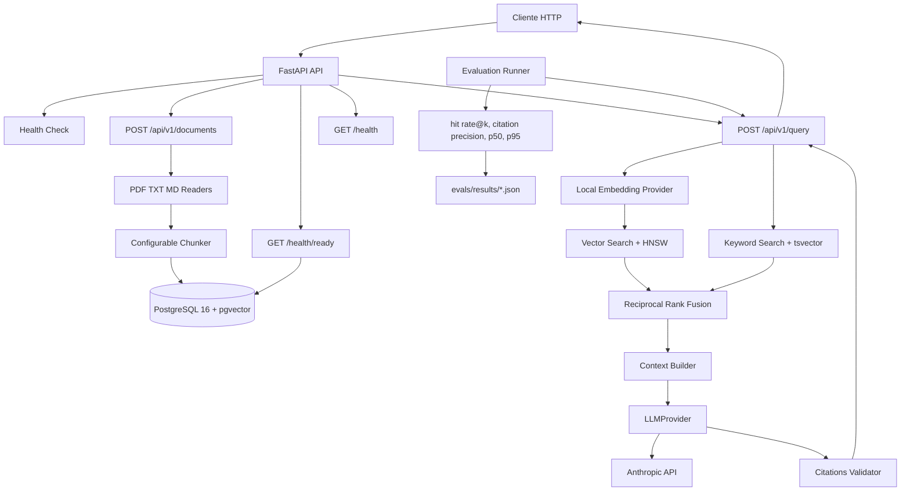

# Arquitectura — `rag-core`

## Estilo general

El sistema será un servicio único con separación por módulos. La API coordina casos de uso; los módulos de dominio no deben depender directamente de FastAPI. Los proveedores externos deben estar detrás de interfaces para que las pruebas puedan usar dobles deterministas.

## Estructura de componentes

```text
app/
├── api/          # Rutas FastAPI y modelos HTTP
├── core/         # Configuración, logging y errores comunes
├── ingestion/    # Lectura de documentos y chunking
├── retrieval/    # Embeddings, búsquedas y RRF
├── generation/   # Prompt, LLMProvider y citas
├── evaluation/   # Dataset, métricas y runner
└── db/           # Modelos, sesión y acceso a PostgreSQL
tests/            # Unitarias, contrato y pruebas de integración
evals/            # Dataset y resultados generados
```

## Componentes y responsabilidades

### API

Expone `/health`, `/health/ready`, `/api/v1/documents` y `/api/v1/query`. Valida entradas, llama a casos de uso y transforma resultados en respuestas HTTP. No contiene lógica de parsing, ranking ni prompts.

### Core

Carga configuración con Pydantic Settings, configura logging y centraliza errores. `ANTHROPIC_API_KEY` se carga únicamente desde el entorno.

### Ingestion

Selecciona el lector según extensión, extrae texto, conserva metadata de página cuando el formato lo permite, calcula checksum y aplica chunking por tamaño y overlap. En la Fase 2, `ready` significa que los chunks fueron persistidos correctamente; no significa que el documento tenga embeddings ni que sea consultable. Esa semántica se revisa en la Fase 3.

### DB

Gestiona sesión y transacciones de PostgreSQL, modelos de documentos y chunks, embeddings y campos `tsvector`. Las migraciones usan Alembic, aprobado para la Fase 2. Se aplican al arrancar el contenedor de la API.

### Retrieval

Genera embeddings de consulta, ejecuta búsqueda vectorial mediante pgvector, búsqueda por palabras clave mediante `tsvector`, y fusiona ambas listas con Reciprocal Rank Fusion. Devuelve chunks ordenados y metadata de citas.

### Generation

Define `LLMProvider`, prepara un prompt con pregunta y contexto, llama a Anthropic mediante el proveedor real y valida la lista de citas. En pruebas usa un proveedor falso o mock.

El modelo objetivo es `claude-haiku-5-5`; su identificador exacto, disponibilidad y parámetros deben verificarse en la documentación oficial de Anthropic antes de implementarlo.

### Evaluation

Lee `evals/dataset.jsonl`, ejecuta consultas con configuración fija, calcula hit rate@k, precisión de citas, p50 y p95 de latencia, imprime consultas y tokens utilizados, y guarda JSON en `evals/results/`.

## Flujo de ingesta

1. El cliente envía un archivo a `POST /api/v1/documents`.
2. La API valida extensión, tamaño y parámetros de chunking.
3. El lector extrae texto y metadata de origen.
4. El servicio calcula checksum y divide el texto.
5. Se persisten documento y chunks.
6. El proveedor local genera un embedding por chunk.
7. En la Fase 2 se actualiza la información necesaria para inspeccionar chunks; los embeddings se agregan en la Fase 3.
8. La API devuelve el documento creado y cantidad de chunks con estado `ready`.

## Flujo de consulta

1. El cliente envía una pregunta a `POST /api/v1/query`.
2. Se genera localmente el embedding de la pregunta.
3. Se ejecuta búsqueda vectorial con pgvector.
4. Se ejecuta búsqueda por palabras clave con `tsvector`.
5. Se fusionan ambas listas usando RRF.
6. Se seleccionan los chunks de contexto hasta el límite configurado.
7. `LLMProvider` recibe pregunta, contexto e instrucciones de grounding.
8. Anthropic genera una respuesta con citas.
9. La aplicación valida las citas contra chunks recuperados.
10. Si el contexto no es suficiente, la respuesta debe indicar que no lo sabe y no inventar información.

## Diagrama Mermaid



## Dependencias externas y pruebas

- Embeddings: implementación real local con `sentence-transformers`; fake determinista en pruebas.
- Generación: implementación real Anthropic; proveedor falso o mock en pruebas.
- Persistencia: PostgreSQL con pgvector; unit tests aislados y pruebas de integración con contenedor de test en Fase 6.

Todas las APIs y versiones deben verificarse en su documentación oficial antes de fijarse en dependencias del proyecto.

